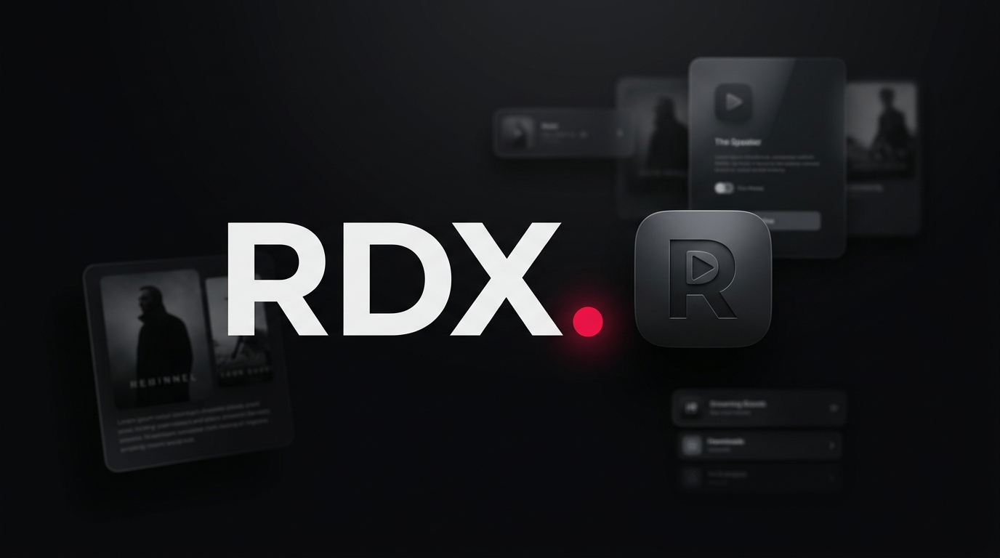
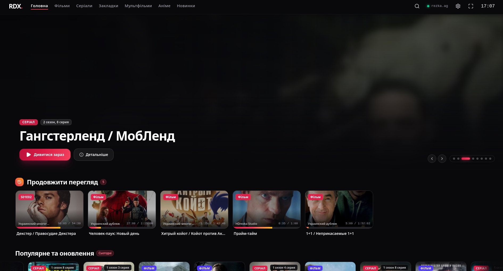
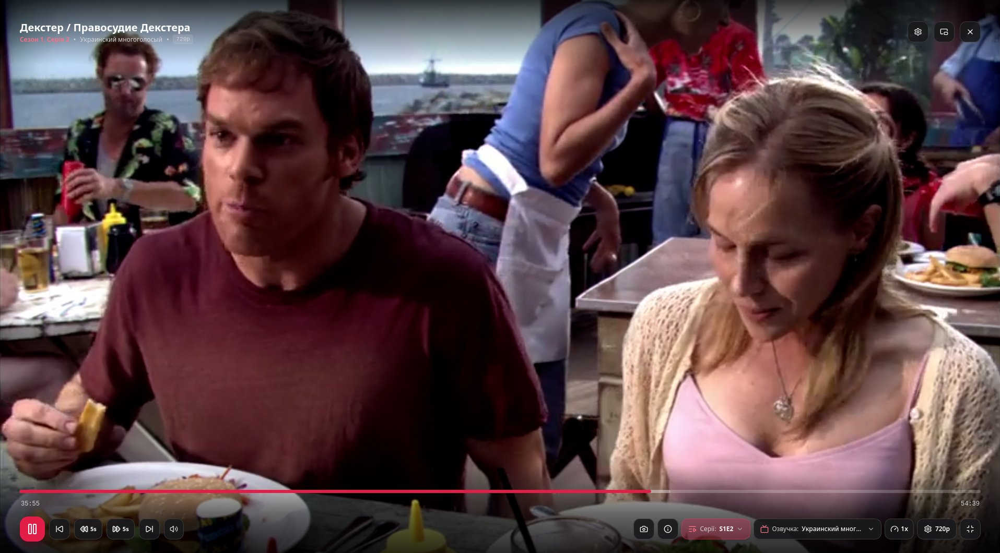
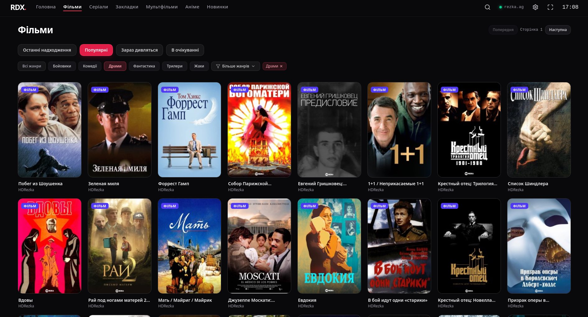

# RDX. — HDRezka Desktop Cinema & Smart TV Client

<p align="center">
  
</p>

<p align="center">
  <b>Native cross-platform desktop streaming client for HDRezka (and its mirrors) with an Android TV / Apple TV inspired interface and Spotify Desktop ergonomics.</b><br/>
  Built with <b>Rust (Tauri v2)</b>, <b>React 19</b>, <b>TypeScript</b>, and <b>Tailwind CSS</b>.
</p>

---

> [!IMPORTANT]
> **🇺🇦 Interface Language Note:**
> Currently, the application interface (menus, OSD controls, and settings) is **exclusively in Ukrainian** (`Українська`), with built-in prioritization and `🇺🇦` badge highlighting for Ukrainian voiceover studios. Multi-language UI localization (English, etc.) is planned for future updates.

---

## ✨ Key Features

- **Smart TV / Cinema UI Aesthetic**:
  - Clean matte obsidian (`#09090b`) & crimson (`#e11d48`) design language with fluid responsive layout adapting to any window size.
  - Native `2:3` poster grid with quality/series badges, full-bleed hero banner, and full-screen release pages.
  - Structured voiceover (translator) selector with instant filter for Ukrainian dubbing/voiceover studios (`🇺🇦`), season switcher, and episode grid.
- **Custom Cinema Video Player (`HLS` + `MP4`)**:
  - **Zero-flash seeking**: RAM-buffered HLS segment pipeline (`hls.js`) + tuned GStreamer software decoding (`avdec_h264`) on Linux/Wayland to eliminate VA-API DMABUF frame stutter.
  - **Glassmorphic Right-Click Context Menu**: On-the-fly switching for Voiceovers, Seasons/Episodes, Video Quality (`360p` to `1080p Ultra`), Playback Speed (`0.25x–2x`), and Aspect Ratio (`Auto`, `Cover`, `Fill`, `16:9`, `21:9`, `4:3`).
  - **Pro Playback Tools**: **A–B Segment Loop (`L`)**, **Instant Frame Screenshot to PNG (`S`)**, **Sleep Timer (`15–90 min`)**, and **Live Stream Diagnostics Overlay (`I`)** (real-time resolution, buffer health, stream type).
  - **Custom Smooth SeekBar**: Buffered range indicator, A–B loop markers, hover timestamp preview tooltip, and clickable elapsed/remaining time toggle (`04:12 / 54:39` ↔ `-50:27 / 54:39`).
- **3 Seamless Window Modes (Single Persistent `<video>` Node)**:
  1. **Full Cinema OSD Mode**: Auto-hiding controls and keyboard navigation.
  2. **Docked In-App Mini-Player**: Draggable picture-in-picture overlay inside the app while browsing the catalog.
  3. **OS-Level Always-on-Top Floating Window (`PiP`)**: Compact frameless floating window across workspaces (including native Wayland / Niri tiling-to-floating support).
  - **External Player Handoff**: 1-click launch into **MPV** or **VLC** at the exact current timestamp.
- **Local Watch Progress & Bookmarks (SQLite)**:
  - Automatically saves playback position (`rdx_data.db`) every 5 seconds along with the selected voiceover studio, season, and episode for 1-click **"Continue Watching"** (`Продовжити перегляд`) from the home screen.
- **HDRezka Mirror & Anti-Bot Session Manager**:
  - Native parser and stream decryptor (`#h` trash-string deobfuscator + AJAX episode/translator resolver) for **HDRezka** (`rezka-tv.org`, `rezka.ag`, `hdrezka.ag`, and custom mirrors).
  - Dynamic mirror switching with real-time latency (ping) checks, custom mirror URLs, and `HTTP` / `SOCKS5` proxy support.
  - Built-in `<1ms` Rust SHA-256 Proof-of-Work (Anubis) solver with persistent cookie jar + fallback WebView Captcha Bridge.

---

## 📸 Скріншоти / Screenshots

<p align="center">
  <b>Головний екран (Продовжити перегляд з прогресом серій та смарт-стрічки)</b><br/>
  
</p>

<p align="center">
  <b>Кінотеатральний відеоплеєр (OSD, вибір озвучки, серій та якість)</b><br/>
  
</p>

<p align="center">
  <b>Каталог фільмів (Швидкі жанрові фільтри, сортування та пагінація)</b><br/>
  
</p>

---

## ⌨️ Player Shortcuts

| Shortcut | Action |
| :--- | :--- |
| `Space` / `K` / Single Click | Play / Pause |
| Double Click / `F` | Toggle Fullscreen (with native Niri / Wayland tiling support) |
| `←` / `→` | Seek **±5 seconds** |
| `Shift + ←` / `Shift + →` | Seek **±30 seconds** |
| `↑` / `↓` | Volume **±5%** |
| `M` | Mute / Unmute |
| `L` | Cycle **A–B Loop** (`Set Point A` → `Set Point B` → `Clear`) |
| `S` | Save current video frame screenshot (`.png`) |
| `I` | Toggle Stream Statistics & Diagnostics overlay |
| `Right Click (RMB)` | Open custom multi-page player context menu |

---

## 🛠 Development & Build

### Prerequisites
- **Rust** (`1.77+`)
- **Node.js** (`20+`)
- Platform WebView & media dependencies (e.g. `webkit2gtk-4.1` and `gstreamer1` plugins on Linux)

### Run in Development Mode
```bash
npm install
npm run tauri dev
```

### Build Production Bundles (`.AppImage`, `.deb`, `.rpm`, `.exe`, `.dmg`)
```bash
npm run tauri build
```

---

## ⚠️ Disclaimer
**RDX** is an unofficial, open-source third-party desktop client for **HDRezka** developed strictly for educational and personal use. It is not affiliated with or endorsed by HDRezka. This application does **not** host, store, archive, or distribute any copyrighted media files on its own servers — all metadata and video streams are fetched directly from publicly accessible HDRezka mirrors configured by the user.
