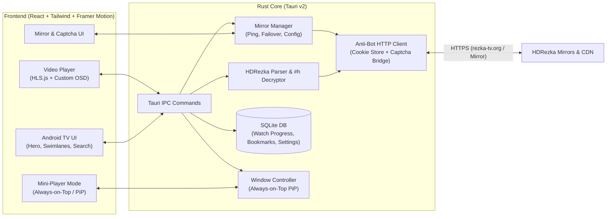

# RDX — Technical Specification & Architecture

## 1. Vision & UX Concept
**RDX** combines the responsiveness and desktop ergonomics of **Spotify Desktop** with the cinematic, immersive visual language of **Android TV / Google TV / Apple TV+**:
- **Dynamic Ambient Hero Banner**: Full-bleed high-resolution backdrop of the currently focused movie/series with radial vignette gradients, smooth cross-fade transitions, IMDb/Kinopoisk ratings, release year, genre pills, and quick actions (`Дивитися`, `Трейлер`, `У закладки`).
- **Navigation**:
  - Top glassmorphic navigation pill bar (`Пошук`, `Головна`, `Фільми`, `Серіали`, `Мультфільми`, `Аніме`, `Моя бібліотека`) + collapsible left quick-rail (Settings, Mirror Status indicator, Mini-Player toggle).
  - Full support for both **Mouse/Trackpad** and **Keyboard/Gamepad/Remote** (`Arrow keys`, `Enter`, `Escape`, `Space`).
- **Horizontal Swimlanes (Carousels)**:
  - **«Продовжити перегляд» (Play Next)** — top priority row showing episodes/movies in progress with a visual progress bar, `S02E05`, and remaining time.
  - Category swimlanes with 16:9 widescreen cards and 2:3 poster cards that scale up (`scale-105`), glow with ambient shadow, and update the Hero backdrop on focus/hover.

---

## 2. Core Functional Requirements

### 2.1. Mirror Manager (Керування дзеркалами та обхід блокувань)
Because HDRezka domains (`https://rezka-tv.org/`, `https://rezka.ag/`, `https://hdrezka.me/`, etc.) are frequently blocked by ISPs:
- **Dynamic Mirror Switcher UI**: Quick modal accessible directly from the top bar (shows connection status badge: Green = Online + ping in ms, Yellow = Captcha Required, Red = Blocked/Offline).
- **Custom Mirrors**: Users can add any new mirror URL (auto-normalized, trailing slash stripped, tested via HEAD/GET request).
- **Auto-Failover & Ping Check**: Parallel health probe in Rust (`mirror::check_mirrors`) that measures response latency and detects ISP block pages vs Cloudflare challenges.
- **Optional Proxy / DoH Support**: Ability to specify a custom HTTP/SOCKS5 proxy in settings if all direct mirrors are blocked.

### 2.2. Anti-Bot & Captcha Handling ("Чи ви не робот")
HDRezka uses Cloudflare protection, session rate-limiting, and occasional reCAPTCHA/Turnstile challenges:
1. **Shared Persistent Cookie Jar**: Rust `reqwest::Client` stores cookies (`cf_clearance`, `PHPSESSID`, `dle_user_id`, `dle_password`) on disk in the app data directory so sessions survive app restarts.
2. **Browser-grade Headers**: Realistic User-Agent matching the system WebView, `Referer` dynamically set to the active mirror URL, `X-Requested-With: XMLHttpRequest` for AJAX calls.
3. **Interactive Captcha Bridge (WebView Verification Modal)**:
   - When the Rust client detects HTTP `403`, `503`, or a captcha form in the HTML response, RDX pops up a built-in verification WebView window pointing to the active mirror.
   - As soon as the user clicks "Я не робот" and the page loads, RDX automatically extracts the cookies + `User-Agent` from the WebView into the Rust client, closes the verification window, and retries the request seamlessly.

### 2.3. Video Player & Stream Decryption
- **Stream Extraction**:
  - Parses translators (voiceovers: Українська, Дніпропетровський, Original + Subtitles, etc.), seasons, and episodes.
  - Calls `POST /ajax/get_cdn_series/` and decodes HDRezka's obfuscated `#h` stream string (strips `//_//` and trash markers, Base64-decodes quality tiers: `360p`, `480p`, `720p`, `1080p`, `1080p Ultra`, `2K`, `4K` with `.mp4` and `.m3u8` HLS manifests).
  - Extracts external subtitle tracks (`.vtt` / `.srt`).
- **Custom Cinema Player**:
  - Quality selector (`1080p Ultra`, `1080p`, `720p`, etc.) with seamless timestamp retention on switch.
  - Audio / Translator switcher & Subtitle selector.
  - Episode drawer & automatic "Next Episode" countdown overlay at the end of an episode.
  - Keyboard shortcuts (`Space` play/pause, `F` fullscreen, `M` mute, `Left/Right` ±10s, `Up/Down` volume, `P` mini-player).

### 2.4. Always-on-Top Mini-Player (Міні-плеєр поверх усіх вікон)
Two seamless modes for multitasking while watching:
1. **In-App Docked Mini-Player (Spotify style)**: When browsing other movies inside RDX while a video is playing, the video shrinks into a sleek floating bar/corner player inside the app.
2. **System-Wide Always-on-Top Window (Browser PiP style)**:
   - Clicking "Згорнути поверх вікон" transforms or detaches the player into a compact, frameless (`decorations: false`), `always_on_top: true` window that floats above all OS windows (browsers, IDE, messengers).
   - Supports dragging anywhere on screen, resizing, hover controls (Play/Pause, ±10s, Next Episode, Expand back to full RDX window), and native Picture-in-Picture fallback.

### 2.5. Watch Progress & Local Database ("Продовжити перегляд")
Stored locally in SQLite (`rdx_data.db`):
- **`watch_history` table**:
  - Saves playback position every 5 seconds and on pause/close.
  - Remembers the exact **Translator (Озвучка)**, **Season**, **Episode**, **Video Quality**, and **Timestamp (`position_sec` / `duration_sec`)**.
  - Marks episodes as watched (>90% progress) and automatically suggests the next episode in the "Play Next" row on the Home screen.
- **`bookmarks` table**:
  - Local favorites lists (`Дивлюсь`, `В планах`, `Переглянуто`, `Улюблене`).

---

## 3. System Architecture

