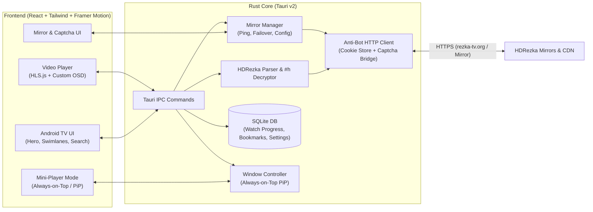

# RDX — Technical Specification & Architecture

## 1. Vision & UX Concept
**RDX** combines the responsiveness and desktop ergonomics of **Spotify Desktop** with the cinematic, immersive visual language of **Android TV / Google TV / Apple TV+**:
- **Dynamic Ambient Hero Banner**: Full-bleed high-resolution backdrop of the currently focused movie/series with radial vignette gradients, smooth cross-fade transitions, IMDb/Kinopoisk ratings, release year, genre pills, and quick actions (`Дивитися`, `Трейлер`, `У закладки`).
- **Navigation**:
  - Top glassmorphic navigation pill bar (`Пошук`, `Головна`, `Фільми`, `Серіали`, `Мультфільми`, `Аніме`, `Моя бібліотека`) + collapsible left quick-rail (Settings, Mirror Status indicator, Mini-Player toggle).
  - Full support for both **Mouse/Trackpad** and **Keyboard/Gamepad/Remote** (`Arrow keys`, `Enter`, `Escape`, `Space`).
- **Horizontal Swimlanes (Carousels)**:
  - **«Продовжити перегляд» (Play Next)** — top priority row showing episodes/movies in progress with a visual progress bar, `S02E05`, and remaining time.
  - Category swimlanes with 16:9 widescreen cards and 2:3 poster cards that scale up (`scale-105`), glow with ambient shadow, and update the Hero backdrop on focus/hover.

---

## 2. Core Functional Requirements

### 2.1. Mirror Manager (Керування дзеркалами та обхід блокувань)
Because HDRezka domains (`https://rezka-tv.org/`, `https://rezka.ag/`, `https://hdrezka.me/`, etc.) are frequently blocked by ISPs:
- **Dynamic Mirror Switcher UI**: Quick modal accessible directly from the top bar (shows connection status badge: Green = Online + ping in ms, Yellow = Captcha Required, Red = Blocked/Offline).
- **Custom Mirrors**: Users can add any new mirror URL (auto-normalized, trailing slash stripped, tested via HEAD/GET request).
- **Auto-Failover & Ping Check**: Parallel health probe in Rust (`mirror::check_mirrors`) that measures response latency and detects ISP block pages vs Cloudflare challenges.
- **Optional Proxy / DoH Support**: Ability to specify a custom HTTP/SOCKS5 proxy in settings if all direct mirrors are blocked.

### 2.2. Anti-Bot & Captcha Handling ("Чи ви не робот")
HDRezka uses Cloudflare protection, session rate-limiting, and occasional reCAPTCHA/Turnstile challenges:
1. **Shared Persistent Cookie Jar**: Rust `reqwest::Client` stores cookies (`cf_clearance`, `PHPSESSID`, `dle_user_id`, `dle_password`) on disk in the app data directory so sessions survive app restarts.
2. **Browser-grade Headers**: Realistic User-Agent matching the system WebView, `Referer` dynamically set to the active mirror URL, `X-Requested-With: XMLHttpRequest` for AJAX calls.
3. **Interactive Captcha Bridge (WebView Verification Modal)**:
   - When the Rust client detects HTTP `403`, `503`, or a captcha form in the HTML response, RDX pops up a built-in verification WebView window pointing to the active mirror.
   - As soon as the user clicks "Я не робот" and the page loads, RDX automatically extracts the cookies + `User-Agent` from the WebView into the Rust client, closes the verification window, and retries the request seamlessly.

### 2.3. Video Player & Stream Decryption
- **Stream Extraction**:
  - Parses translators (voiceovers: Українська, Дніпропетровський, Original + Subtitles, etc.), seasons, and episodes.
  - Calls `POST /ajax/get_cdn_series/` and decodes HDRezka's obfuscated `#h` stream string (strips `//_//` and trash markers, Base64-decodes quality tiers: `360p`, `480p`, `720p`, `1080p`, `1080p Ultra`, `2K`, `4K` with `.mp4` and `.m3u8` HLS manifests).
  - Extracts external subtitle tracks (`.vtt` / `.srt`).
- **Custom Cinema Player**:
  - Quality selector (`1080p Ultra`, `1080p`, `720p`, etc.) with seamless timestamp retention on switch.
  - Audio / Translator switcher & Subtitle selector.
  - Episode drawer & automatic "Next Episode" countdown overlay at the end of an episode.
  - Keyboard shortcuts (`Space` play/pause, `F` fullscreen, `M` mute, `Left/Right` ±10s, `Up/Down` volume, `P` mini-player).

### 2.4. Always-on-Top Mini-Player (Міні-плеєр поверх усіх вікон)
Two seamless modes for multitasking while watching:
1. **In-App Docked Mini-Player (Spotify style)**: When browsing other movies inside RDX while a video is playing, the video shrinks into a sleek floating bar/corner player inside the app.
2. **System-Wide Always-on-Top Window (Browser PiP style)**:
   - Clicking "Згорнути поверх вікон" transforms or detaches the player into a compact, frameless (`decorations: false`), `always_on_top: true` window that floats above all OS windows (browsers, IDE, messengers).
   - Supports dragging anywhere on screen, resizing, hover controls (Play/Pause, ±10s, Next Episode, Expand back to full RDX window), and native Picture-in-Picture fallback.

### 2.5. Watch Progress & Local Database ("Продовжити перегляд")
Stored locally in SQLite (`rdx_data.db`):
- **`watch_history` table**:
  - Saves playback position every 5 seconds and on pause/close.
  - Remembers the exact **Translator (Озвучка)**, **Season**, **Episode**, **Video Quality**, and **Timestamp (`position_sec` / `duration_sec`)**.
  - Marks episodes as watched (>90% progress) and automatically suggests the next episode in the "Play Next" row on the Home screen.
- **`bookmarks` table**:
  - Local favorites lists (`Дивлюсь`, `В планах`, `Переглянуто`, `Улюблене`).

---

## 3. System Architecture

---

## 4. Linux WebKitGTK Runtime & Memory Safeguards (`src-tauri/src/main.rs`)
To prevent Wayland DRM/GBM (`i915.gem` / `drm-total-system0`) Shmem leaks and excessive `WebKitWebProcess` CPU usage on Linux (especially Intel Iris Xe / Wayland AppImage builds):
- **GStreamer CPU Sink Path**: Sets both `WEBKIT_GST_DMABUF_SINK_DISABLED=1` and `WEBKIT_GST_DISABLE_GL_SINK=1` alongside software `avdec_h264:MAX`, preventing fallback to `WebKitGLVideoSink` (`gstglcontext`) that otherwise leaks `i915.gem` YUV textures into Shmem/zram.
- **SHM Transport & GBM Disable**: Sets `WEBKIT_DMABUF_RENDERER_FORCE_SHM=1`, `WEBKIT_DMABUF_RENDERER_DISABLE_GBM=1`, and `WEBKIT_WEBGL_DISABLE_GBM=1` on non-NVIDIA Linux GPUs (NVIDIA uses `WEBKIT_DISABLE_DMABUF_RENDERER=1`).
- **Skia CPU Tile Rendering**: Sets `WEBKIT_SKIA_ENABLE_CPU_RENDERING=1` and bounded `WEBKIT_SKIA_CPU_PAINTING_THREADS` (`1–2` threads) to avoid `SkiaGPUWorker` GL contexts and GPU->CPU tile readbacks under SHM transport.

---

## 5. RDX Labs — Experimental Suite (`src/services/labs.ts`, `src/components/LabsSettingsPanel.tsx`)
Controlled by a strict **Master Kill-Switch** (`enabled = false` by default; turning Labs off immediately deactivates and unmounts all experimental shaders, canvases, timers, and UI menus):
- **Frame Boost (24 FPS → 48/60 FPS)** (`src/utils/videoShaders.ts` v6): Ping-pong 2-frame motion-adaptive Anti-Judder blending (`smooth`) and WebGL2 `240×135` pyramid coarse Lucas-Kanade/block optical flow with bidirectional warp & confidence fallback (`flow`), plus automatic FPS watchdog degradation on low-end GPUs.
- **Vendor-Agnostic Smart Upscaler (Intel UHD/Iris Xe, NVIDIA, AMD, Apple Silicon)**: Edge-Adaptive directional spatial upscaling (`cinema`), `Anime4K-Fast` contour line thinning (`anime`), and content-aware `auto` mode scaling `<1080p` streams up to Full HD.
- **Cinema Ambilight (`src/utils/ambilight.ts`)**: `32×18` temporal-smoothed ambient canvas (~11 Hz, `<0.2%` CPU/GPU) illuminating 21:9 / 4:3 black bars.
- **Smart Series Intro Skip (`src/utils/introDetector.ts`)**: Local 64-bit `dHash` perceptual matching across episode WebVTT thumbnail sprite sheets + 1-click manual season intro calibration.
- **Clear Dialogue 2.0 (`src/utils/dialogueEnhancer.ts`)**: CORS-safe Mid/Side speech isolator & compressor (`185Hz` HPF, `+6dB` @ `1.65kHz`) with an `AnalyserNode` silence watchdog and bit-transparent bypass.
- **Laptop Eco Battery Saver**: Manual or automatic (`<= 30%` unplugged via `navigator.getBattery()`) pure `#000000` OLED override, `720p` stream cap, extended HLS Wi-Fi sleep buffer (`150s/240s`), and automatic pause of GPU-intensive Labs shaders.
- **Local Loopback CORS Stream Proxy (`src-tauri/src/stream_proxy.rs`)**: Ephemeral `127.0.0.1:<port>` Rust proxy rewriting `.m3u8` manifests, `.vtt` sprites, and Range `.mp4`/`.ts` streams with `Access-Control-Allow-Origin: *` so HLS.js MSE, WebGL Frame Boost/Upscaler, Ambilight, Screenshots, and WebAudio work across 302-redirected Voidboost storage nodes.
